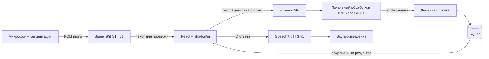

# Архитектура

> Дополнение от 30.10.2026: по новому поручению реализованы CallMe, аккаунты и совместная работа. Актуальные правила и проверка — [callme-team.md](callme-team.md). Указания ниже об отсутствии регистрации относятся к предыдущему этапу.
## Выбор технологий

Исходная рабочая папка была пустой, Git и установленный стек отсутствовали. Выбран один TypeScript-проект: React 19 + Vite 8 для клиента, Express 5 на Node.js 24 для API, встроенный SQLite для постоянного локального хранилища. Точные версии зафиксированы в `package-lock.json`. Для русского времени используется chrono-node, все даты проверяются сервером и интерпретируются в Europe/Moscow.

STT/TTS проходят только через серверный `/api/voice/*`; ключ не попадает в браузер. На схеме провайдеры показаны отдельными границами, а не прямыми клиентскими вызовами.

## Модули

| Модуль | Ответственность |
|---|---|
| `src/App.tsx` | Навигация, чат, состояние запроса, подтверждения и восстановление после ошибки |
| `src/components/kanban-board.tsx` | Колонки, поиск, фильтры и смена статуса мышью или клавиатурой |
| `src/components/settings-panel.tsx` | Описание сервисов и тема оформления |
| `src/lib/links.ts` | Общая клиентская и серверная проверка HTTPS-ссылок |
| `src/components/event-editor.tsx` | Формы и доступная валидация только редактируемых полей |
| `src/components/event-list.tsx` | Периоды, фильтры, поиск по названию, страницы результатов |
| `src/components/ui/` | Исходники официальных компонентов shadcn/ui |
| `src/lib/voice.ts` | Захват PCM, паузы, остановка потоков/воспроизведения, отмена сетевых запросов |
| `server/app.ts` | Cookie, проверка входа, изоляция, сериализация запросов пространства, HTTP |
| `server/domain.ts` | Уточнения, выбор, даты, пересечения, CRUD, выполнение; не обращается к AI |
| `server/providers.ts` | Проверенный по документации контракт Yandex, таймаут, бюджетный резерв |
| `server/store.ts` | SQLite, валидация CSV, повторяемый импорт, персистентный резерв API |

## Модель и безопасные переходы

Событие содержит ID, тип, название, date/time/duration с явным null, completed, inferred, revision, createdAt/updatedAt. Для импорта сохранён неизменяемый `original`. `inferred` не снимается при простом переносе.

Пространство содержит события, историю сообщений, выбранную запись, ожидающее уточнение и обработанные requestId. Ожидание имеет тип draft, choose, speech, delete, past или conflict. Голосовое уточнение сохраняет предыдущий черновик. Несколько совпадений требуют выбора; один результат становится выбранным автоматически. Результаты показываются с номерами, датами и названиями.

Создание с достаточными данными выполняется сразу. Удаление сначала создаёт ожидание с копией цели и revision. Подтверждение проверяет токен и актуальность цели. Для встречи проверяются интервалы известных длительностей; неизвестная длительность исходной записи проверяется только по совпадению начала. Соседние интервалы не конфликтуют. Прошедшая дата требует явного решения.

Запросы одного пространства сериализованы. Клиент назначает requestId и при повторе использует тот же ID. События, сообщения и ID сохраняются одним SQLite UPSERT: после сетевого обрыва повтор не создаёт дубль. Ошибка SQLite не даёт успешного ответа. Изменения формы передают revision, устаревшее состояние отклоняется.

## UI/UX и shadcn

Навигация Sidebar: «Диалог» и «Все записи» — два представления одних данных. «Новая запись» — Dialog с FieldGroup/Field, Select и Input. На десктопе рядом с чатом список; на мобильном — Sheet. Диалог использует MessageScroller, Message, Bubble, Avatar. Карточки результатов — Item, подсказки — Card, состояния — Alert/Skeleton/Empty/Badge, выбор периода — ToggleGroup, удаление/конфликт/прошлое — AlertDialog.

Стиль Radix Nova. Цветовые изменения сделаны только в общих CSS-переменных shadcn; сетки и размеры заданы Tailwind. Все кнопки, поля, переключатели, меню и диалоги — официальные shadcn-компоненты. Radix — их штатная примитивная основа, не параллельная UI-система.

Локальные изменения upstream-компонентов: русские accessibility-подписи; InputGroup считает отключённым только input/textarea, а не всю группу из-за disabled-кнопки отправки; клик по addon фокусирует также textarea. Эти изменения нужны для наблюдённого поведения чата, остальные компоненты не перерисованы.

## Ограничения архитектуры прототипа

Одна SQLite-база и один процесс сервера; очередь живёт в процессе, отдельные экземпляры сервера потребуют другого механизма сериализации. Данные пространства хранятся JSON-документом; для 1000 событий это просто и достаточно, для больших наборов нужна нормализованная схема и серверная пагинация. История и idempotency-ключи пока без автоочистки. Публичная защита от массового создания пространств и злоупотребления оплачиваемым API требует отдельной проверки перед деплоем. Публичная готовность не заявляется.

## Официальные источники контрактов

Проверены 30.10.2026:

- [shadcn/ui и установка Vite](https://ui.shadcn.com/docs/installation/vite).
- [Skill shadcn](https://ui.shadcn.com/docs/skills).
- [YandexGPT REST Completion](https://aistudio.yandex.ru/en/docs/ai-studio/text-generation/api-ref/TextGeneration/completion).
- [SpeechKit STT v1: ограничения и PCM](https://aistudio.yandex.ru/ru/docs/speechkit/stt/api/request-api).
- [SpeechKit TTS v1](https://aistudio.yandex.ru/ru/docs/speechkit/tts/request).

Версия и качество конкретной модели Yandex не подтверждены: URI задаётся владельцем после проверки доступов. Контракт API не является доказательством успешного живого запроса.

## Проекты и канбан

Дополнительные поля JSON-пространства совместимы со старыми данными: `projects` (ID и имя), `projectId`, `status`, `callUrl`, `links`. Отсутствие проекта означает «Без проекта». Для старых статусов используется `completed`: true → done, false → todo; команда `move` синхронно обновляет оба поля. Это смена состояния работы, поэтому она не изменяет дату и не вызывает повторное подтверждение старого срока.

Команды `createProject` и `move` используют ту же очередь пространства, requestId и сохранение, что формы и чат. Перемещение проверяет revision, принадлежность записи и допустимый статус. Создание/изменение проверяет существование projectId в своём пространстве. Параметр projectId у текстового запроса применяется только к созданию; хранится в черновике и подтверждении речи. Он не меняет область поиска и не переносит ранее выбранную запись.

Ссылки не загружаются сервером: сохраняется только пользовательский адрес, внешние страницы открываются по явному нажатию в новой вкладке с `noopener noreferrer`. Автоматические OAuth-соединения, чтение содержимого и внешние записи не реализованы. Новые поля управления проектами и ссылками не могут быть заполнены моделью YandexGPT: они проверяются отдельно от её текстовой команды.
